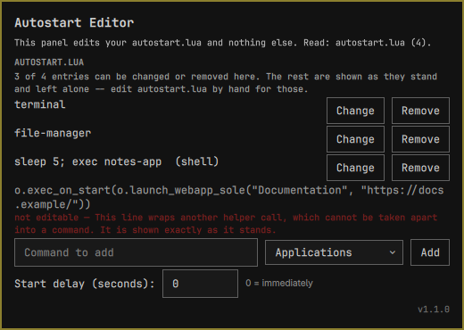
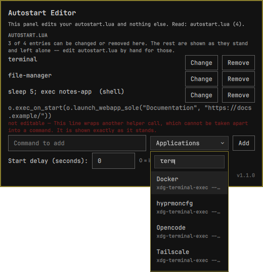
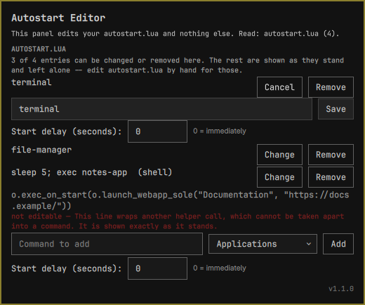

# Autostart Editor

An Omarchy bar widget for Hyprland: an editor for the one Hyprland file that
decides which programs your session starts.



## Screenshots

These screenshots come from the installed plugin running in Omarchy. They use
a temporary neutral `autostart.lua` fixture; no personal command lines or
desktop content are included.

### Search installed applications

The application picker filters by both application name and the cleaned
desktop-file command. Its result popup is bounded and virtualized, so opening
it does not instantiate every installed application at once.



### Edit a command and its delay

Changing an entry opens its command and delay in place. **Save** is explicit;
saving unchanged values is a no-op and never starts the writer.



## What it is

One file, one panel:

```
~/.config/hypr/autostart.lua
```

This plugin shows what is in that file, and adds, changes and removes entries
in it. That is all it is. There is no configuration of its own, nothing is
applied to the running compositor, nothing is started and nothing is reloaded
-- your entries take effect at your next login, exactly as they did before
this plugin existed, because starting them was never this plugin's doing. It
is Hyprland's.

An earlier version kept a list of its own in
`~/.config/omarchy/autostart-layout.json` and applied it at login through
`hyprctl eval`, with window rules, a workspace-to-monitor table, a placement
model, a launch route and a start marker. That was a second source of truth
for a fact Hyprland already owned, and it is gone -- code, tests and all. If
you used it, the JSON file is still on disk and nothing reads it; delete it
when you like.

## What it does

Opens a panel behind a bar button and lists every entry of your
`autostart.lua`, one under another. `o.launch_on_start` and `o.exec_on_start`
are read, and
`o.exec_on_start(o.launch(...))` is shown identically to
`o.launch_on_start(...)`, because
`/usr/share/omarchy/default/hypr/helpers.lua` defines them to be the same
thing.

From the panel you can:

- **add** a command -- typed by hand, or picked from your installed
  applications. The application popup is searchable by name and command, and
  its bounded `ListView` creates only visible rows even when the system has
  thousands of desktop entries. Picking one **fills the field**; it does not
  write. The line that goes into a file which runs at every login is one you
  have read first.
- **change** one entry -- exactly the line you picked, no other.
- **delay** a start by 0–3600 whole seconds using **Start delay (seconds)**
  in the add or change form. Zero starts immediately. The delay is stored in
  `autostart.lua`, not a separate file, and is shown in the entry list.
  Delayed entries remain editable; their command and delay are shown separately.
  Each delay runs independently and does not hold up other autostarts.
- **remove** one entry -- exactly the line you picked, no other.

The panel is keyboard-operable: `Up`/`Down` or `k`/`j` move between entries,
`Left`/`Right` or `h`/`l` move between actions, and `Enter` or `Space`
activates the highlighted control. `Delete`/`x` only highlights **Remove**;
activation is still a separate confirmation. Press `/` to open application
search, `a` to focus the add command, and `r` to reread the file. `Escape`
backs out of a field, editor, or subview before closing the panel.

A line that calls one of those helpers in a form the reader cannot take apart
-- a nested helper such as
`o.exec_on_start(o.launch_webapp_sole("Chat", "..."))` -- is shown **as it
stands**, marked *not editable*, with the reason in plain words. An entry that
runs through `o.exec_on_start` rather than the `uwsm-app` launcher is marked
`(shell)`, because that is the one thing about an entry you cannot see from the
command itself. It is never
guessed at and never silently left out, and it can be neither changed nor
removed: for those, edit the file by hand. That is a real limitation and it is
named on screen rather than hidden. A line that calls none of those helpers is
not an entry at all; it belongs to your file.

The build is in the bottom right of the panel -- `v1.1.0` for this release --
so two machines running different builds can be told apart at a glance. It is
not written into the panel: it comes from one constant that a test pins to
`manifest.json` in both directions, so the number shown is the number the
build actually is.

Nothing here needs elevated rights. There is no system-wide tier, no elevation
helper, no package installation and no rule file of any kind. Everything the
plugin does, it does as you, in your own configuration directory.

### What writing `autostart.lua` means, precisely

It is **line surgery**. Your comments, your blank lines and every form the
reader cannot represent stay byte for byte as you wrote them; **add** appends
one line as the last line, in the style the file already uses, and is not
sorted into a "matching" comment section, because guessing which of your
section comments a program belongs under is exactly the surprise this design
avoids.

Saving an entry without changing its command or delay is a no-op: the panel
says there is nothing to save and does not start the writer, create a backup,
or change the file's timestamp.

Four things stand between a change and your next login:

1. The new file content is produced by a **pure function** in `Model.js` -- old
   text plus one operation gives new text, no file I/O -- so every case is a
   unit test with a byte-exact expected result, plus the assertion that old and
   new differ in exactly one line.
2. A command that cannot be written as a readable Lua string literal -- a line
   break, a control character, a NUL -- is **refused**, with a sentence saying
   why, rather than encoded into something unreadable.
3. The candidate is compiled with `luac5.1 -p` **before** anything is renamed
   into place. `-p` parses without executing. A file that would not compile is
   never published, and the original is left byte for byte as it was.
4. **Every write takes its own dated backup** and the file is replaced by an
   atomic rename. The newest five are kept and older ones pruned:

   ```
   autostart.lua.smartalb-autostart.20260903-101810.bak
   ```

   The name says who wrote it, so you can tell this plugin's backups from
   Omarchy's own `autostart.lua.pre-apply.*.bak` and from anything you keep
   there yourself -- and nothing but that exact pattern is ever pruned. If a
   backup cannot be taken, the write is refused rather than done without one.
   The reader attaches a SHA-256 fingerprint of the exact bytes delivered to
   the panel. The writer compares both that fingerprint and the modification
   time with the file descriptor it opened, and refuses the write if either
   differs. This catches hand edits even when they happen within the same
   whole second: a line number from a stale read may name a different line.
   The panel always supplies this fingerprint. The low-level writer CLI keeps
   `--expect-sha256` optional only for compatibility with older developer test
   calls; it is not the production panel contract.

A change takes effect **at your next login.** The plugin starts nothing and
reloads nothing.

### What it needs

- Hyprland with Omarchy's Quickshell-based shell (this is a `bar-widget`
  plugin, schema version 1).
- **`jq`** for every JSON envelope the helper scripts answer with, and
  **`luac5.1`** for the syntax gate that refuses a candidate `autostart.lua`
  before it is written. `luac5.1` ships with `lua51`; `/usr/bin/luac` and
  `/usr/bin/luac5.4` are accepted as fallbacks, each verified by running it
  rather than by trusting its name.
- **`realpath`**, and it is worth naming on its own because it is
  load-bearing for a refusal rather than a convenience: `install` and
  `uninstall` resolve a path with `realpath -m` and then require the result to
  be where it claims to be *before* anything is deleted. Without it both
  would be running `rm -rf` against a path assembled from variables, which is
  the shape that once became `rm -rf /` in this project's own test sandbox.
  (The backup pruner refuses by a different route -- an anchored match on the
  file name -- and needs no external command for it.)
- **`bash`, `timeout`, and the usual coreutils** -- `awk`, `chmod`, `cp`,
   `date`, `env`, `find`, `grep`, `head`, `mktemp`, `mv`, `rm`, `sed`, `sleep`,
   `sha256sum`, `sort`, `stat`, `tr`, `wc`. All present on any Omarchy install; none of them
  is optional and none is fetched. Every one of them is invoked by an
  **absolute path** from a block at the top of each script, and each script
  runs with `PATH` set to nothing, so none of these is resolved through the
  environment.
- **`mv --exchange`, and therefore coreutils 9.5 or newer, is REQUIRED to
  save.** This is the one hard platform requirement this plugin adds, so it is
  spelled out rather than left in a commit message.

  The publish of `autostart.lua` is an atomic *exchange* (`RENAME_EXCHANGE`)
  rather than a one-way rename. That is not a detail: it is what leaves the
  writer holding whatever was actually replaced, so a version of the file that
  appeared while the writer was working can be recognised and **preserved**
  instead of silently overwritten. `--exchange` arrived in coreutils 9.5
  (2024), and the filesystem has to support the call -- ext4, btrfs, xfs and
  tmpfs all do, which covers `~/.config` on any normal Omarchy install.

  **Where it is unavailable, the panel REFUSES to save and says so** (a worded
  message; the envelope code is `no-atomic-exchange`). It does not fall back to
  a plain rename. That fallback existed during development and was removed on
  purpose: it publishes with exactly the defect the exchange exists to close --
  an intervening version overwritten with nothing said -- and a plugin may
  refuse to write a login file, but it may not write one unsafely and file a
  note about it. A refusal costs nothing that matters: the backup is taken
  before the publish, so the validated state is still on disk, and your own
  file is untouched. Reading `autostart.lua` needs none of this; only saving
  does. Nothing is fetched or installed either way.
- **`hyprctl`** only for the running-programs picker, which reads
  `hyprctl -j clients`. That picker is switched off in this release, so
  nothing in this plugin currently calls `hyprctl` at all -- the script that
  would is still shipped, and would need it.

**Nothing is fetched at runtime and the plugin makes no network connection at
all.** Every command above is expected to be on the system already; none is
downloaded, installed or updated by this plugin.

### When something else is a better fit

Your editor. `autostart.lua` is a small hand-written file and `nvim` can do
anything to it that this panel can, faster. What the panel offers is the
overview: your entries in one list, the forms it will not touch marked apart,
and the installed-applications picker to save you typing a command out.

## Known limits

- A line the reader cannot take apart can be neither changed nor removed. It
  is shown as it stands, with the reason.
- A command may be at most 500 characters, and must be writable as a readable
  Lua string literal.
- The panel edits `autostart.lua` and nothing else. It is not a window-rule
  editor and it does not pin workspaces to monitors -- for those, edit
  `windowrules.lua` and `workspaces.lua` by hand. It does not read them
  either.
- The panel cannot tell you whether an entry actually starts. Hyprland starts
  them at login, detached, and a misspelled command, a missing binary and a
  program that exits immediately all look the same from here.
- A file larger than 64 KiB is shown as far as it was read, marked as cut
  short, and is not writable: line surgery against a partial read would target
  line numbers the file does not have.
- A symlinked `~/.config/hypr` directory is readable but not writable from the
  panel. Safely writing through a directory link would require descriptor-
  relative filesystem operations that the Bash writer cannot provide. A
  symlinked `autostart.lua` is refused separately for the same fail-closed
  reason. Use a real Hyprland configuration directory or edit the linked file
  by hand.

## Install

Omarchy installs plugins itself, and that is the way to do it:

```bash
omarchy plugin add https://github.com/SmartALB/omarchy-autostart-editor.git --enable
```

That clones into `~/.config/omarchy/plugins/smartalb.autostart/` and `--enable`
places the widget in your bar for you -- it asks which section and falls back
to the plugin's own default, which is `right`. **There is nothing to edit in
`shell.json` by hand.**

Two things worth knowing before you run it somewhere unusual:

- **Over SSH, add `--yes`.** `--enable` asks for the bar section
  interactively; with no terminal attached it needs `--yes` to take the
  default instead.
- **`omarchy plugin list` and `omarchy plugin enable` need a graphical
  session.** Outside one they fail with `OMARCHY_PATH is not set`. Installing
  over SSH works; verifying it there does not.

The sibling commands are the rest of the lifecycle:

```bash
omarchy plugin list                     # what is installed, and whether it is enabled
omarchy plugin update                   # pull the newest version of every plugin
omarchy plugin enable smartalb.autostart
omarchy plugin disable smartalb.autostart
omarchy plugin remove smartalb.autostart
```

After installing, restart the shell so the widget appears:

```bash
omarchy restart shell
```

To check it took:

```bash
omarchy plugin list | grep smartalb.autostart
```

The row should read `enabled` and list `bar-widget`.

### Installing from a clone, for development

`./install` and `./uninstall` are the **developer** path -- what you use when
you are changing the plugin, not what a user needs:

```bash
git clone https://github.com/SmartALB/omarchy-autostart-editor.git
cd omarchy-autostart-editor
./install
omarchy restart shell
```

`./install` puts the plugin at `~/.config/omarchy/plugins/smartalb.autostart/`
and prints what to do next. It refuses to run as the root user, because it
installs into a per-user configuration directory. It does **not** place the
widget in your bar -- `omarchy plugin enable smartalb.autostart` does that, or
Omarchy's own plugin screen.

**An upgrade replaces that directory rather than copying into it**, so a file
this plugin no longer ships cannot survive in your installed copy. The new
content is built in a scratch directory beside the target and renamed into
place; if anything goes wrong in between, the previous version is put back.

### Removal

```bash
omarchy plugin remove smartalb.autostart
```

From a clone, `./uninstall` does the same for the directory: it removes the
plugin and nothing else -- it refuses to delete anything that does not resolve
to exactly that directory -- and leaves the bar entry for
`omarchy plugin disable` or the plugin screen to clear. Your autostart entries
are in your own `autostart.lua` and keep working without the plugin; the
backups it took, if any, are beside it as
`autostart.lua.smartalb-autostart.*.bak` and are left for you to keep or
delete.

## Where your data lives

Your Hyprland configuration lives where it always did, and this plugin has one
file in it:

```
~/.config/hypr/autostart.lua        read, and written one line at a time
~/.config/hypr/autostart.lua.smartalb-autostart.<date>-<time>.bak
                                    one per write, newest five kept
```

That file holds **command lines that are run as you when your session
starts**, which is worth remembering before pasting a command into it -- from
this panel or from anywhere else.

Two consequences, both deliberate:

- The plugin **refuses to write** `autostart.lua` if it can be written by
  someone else, if it is a symlink, or if it changed on disk since the panel
  read it. It says which of those it was, in plain words, and changes nothing.
- The plugin touches no other configuration. It does not write to
  `hyprland.conf`, to any other `.lua` under `~/.config/hypr/`, or to your
  `shell.json`, and it writes nothing at all until you ask it to.

## Development

Three traps, each with the symptom you will recognise it by:

- **Run `omarchy restart shell` after every QML change.** The develop guide
  says saved changes reload automatically; for bar widgets that is not true.
  *Symptom:* the journal writes `Local plugin changed, reloading`, and the
  widget still behaves like the previous version -- diagnostic output you just
  added does not fire at all.
- **After touching a plugin file, wait about 8 seconds before measuring
  anything.** The inotify watcher reloads the shell and takes running
  `Process` objects down with it. *Symptom in the journal:*
  `another handler is registered for target`.
- **Use `/usr/lib/qt6/bin/qml` for the test suite.** `/usr/bin/qml` on Arch is
  Qt 5.15, does not load the harness at all, and exits 2 -- which collides
  with the runner's own "cannot run". The tool that fails with **no output
  whatsoever** and status 1 is `/usr/bin/qmltestrunner`, which is why it is
  not used here. The runner's five exit codes: `0` green, `1` a test failed,
  `2` cannot run, `3` the harness itself broke, `4` the assertion-count guard
  failed.

`CHECKLIST.md` lists everything no automated test in this repository can
settle -- every claim that needs a running Hyprland session to confirm.

## Tests

```bash
./test/run-tests.sh        # the bin/ scripts, the manifest, install/uninstall
./test/run-qml-tests.sh    # Model.js, headless, in the Qt6 engine
./test/qml-structure.sh    # structural checks over the QML files
./test/runners-shape.sh    # runnerOut/runnerErr, run through a real bash
./test/write-argv.sh       # the write's argv, against a real /proc/<pid>/cmdline
./test/mutations.sh        # every test above, checked against its own mutation
```

`mutations.sh` is the one worth explaining: it breaks a guarded property on
purpose, one at a time, and fails if the suite stays green. A test that
survives the removal of the thing it tests was never testing it.

## License

MIT. See `LICENSE`.
